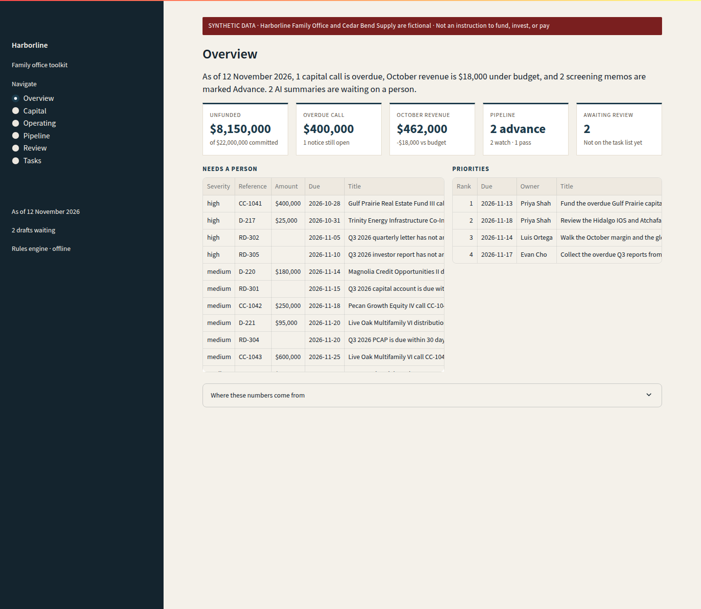
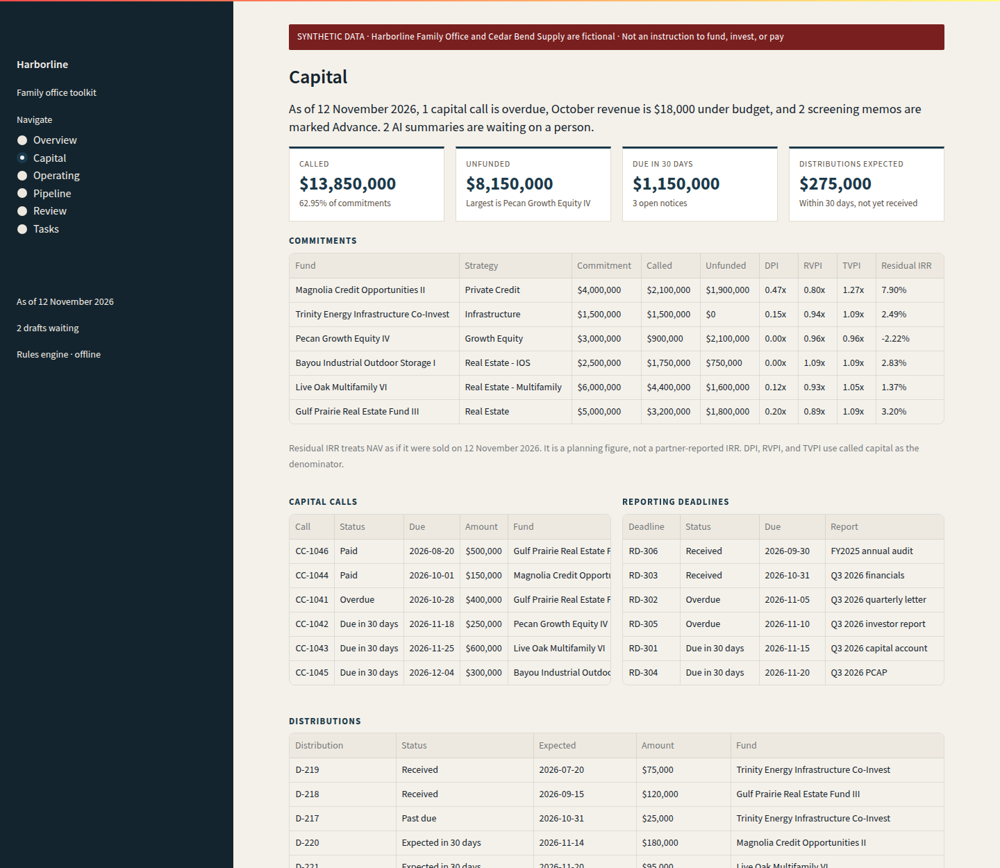
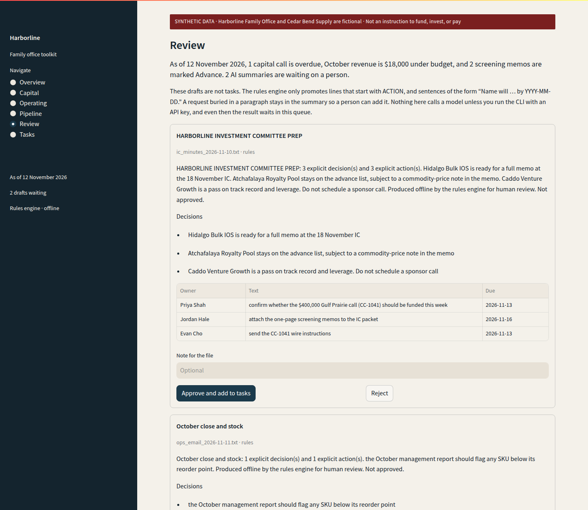
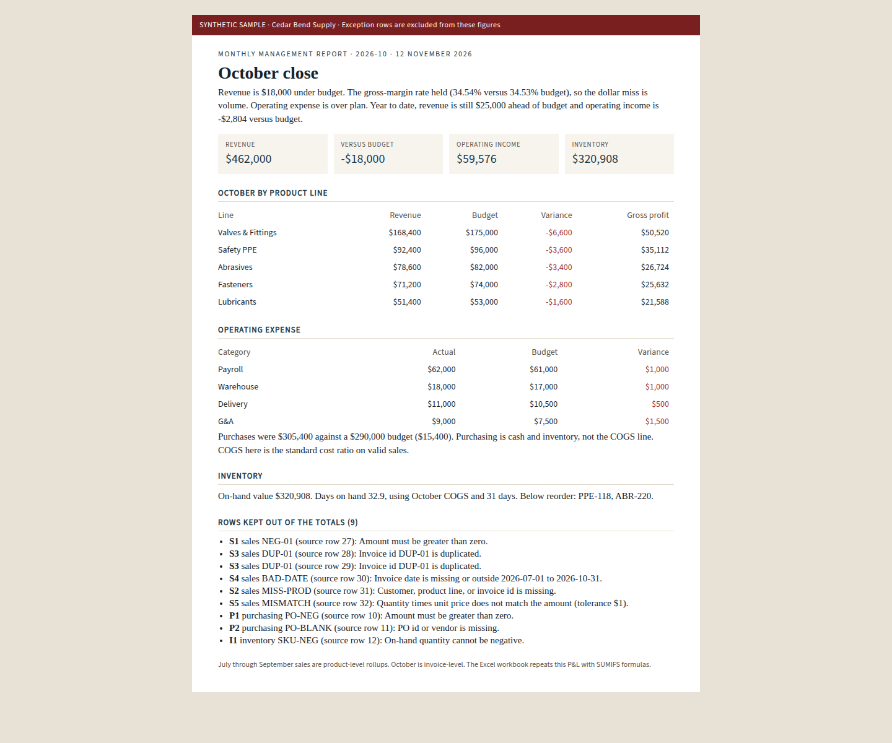
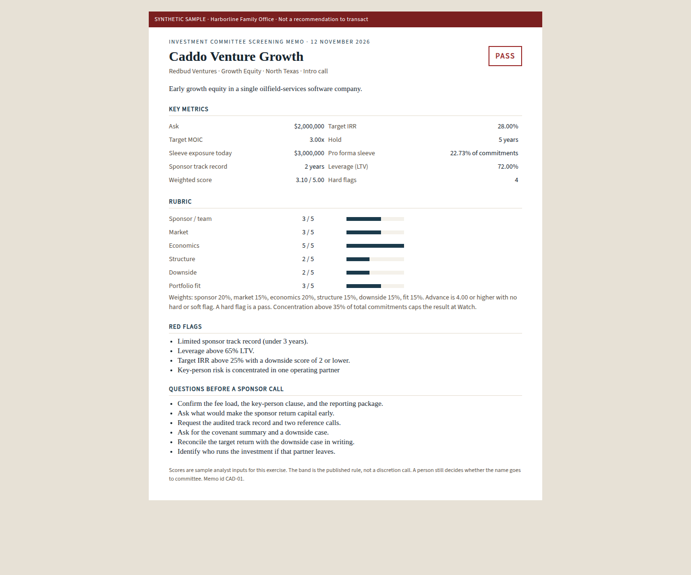

# Family Office Automation Toolkit

Harborline Family Office is a fictional Houston family office. Cedar Bend Supply is its fictional operating company, a small industrial distributor. Nothing in this repo is a client file. The job it is built for is a Business Automation & AI Analyst: map the work, take the retyping out, and leave a number a principal can trace.

As of 12 November 2026, on the sample ledger: **1 capital call is overdue, October revenue is $18,000 under budget, and 2 screening memos are marked Advance. 2 AI summaries are waiting on a person.**

That sentence is produced by `python -m fotoolkit run-all`. It is not a slide caption.

## The business problem

A small office that also owns an operating company runs capital calls, deal screening, the monthly close, and follow-ups out of inboxes and spreadsheets. The failure mode is ordinary. A notice sits in a thread past its due date. A screening memo looks different every time. The monthly pack is pasted together, so a bad invoice can land inside the revenue number. Leadership then asks for the same figure twice, and nobody is sure which version was signed.

The principal does not need another dashboard of charts. They need three things: what is late, what changed versus the plan, and a rule that a machine-written task does not exist until a person has read it.

## What this run shows

All figures are from the synthetic files in `data/sample`, calculated as of **12 November 2026**. Full precision is in `outputs/dashboard.json`. Dollars below are whole dollars. Rates are rounded from that file.

### Capital, distributions, and deadlines

Six funds. Commitments **$22,000,000**. Called **$13,850,000** (62.95%). Unfunded **$8,150,000**. NAV **$12,800,000**. Distributions received **$2,350,000**.

| Item | Result |
| --- | --- |
| Overdue capital call | CC-1041, Gulf Prairie Real Estate Fund III, **$400,000**, due 28 October 2026, still open |
| Calls due within 30 days | **$1,150,000** across three notices (Pecan $250,000 on 18 November, Live Oak $600,000 on 25 November, Bayou IOS $300,000 on 4 December) |
| Past-due distribution | Trinity Energy Infrastructure, **$25,000**, expected 31 October, not marked received |
| Distributions expected within 30 days | **$275,000** (Magnolia $180,000 on 14 November, Live Oak $95,000 on 20 November) |
| Overdue fund reports | 2: Pecan Q3 letter (due 5 November) and Bayou IOS investor report (due 10 November) |
| Largest unfunded balance | Pecan Growth Equity IV, **$2,100,000** |

Pecan is also the only fund under 1.00x TVPI (0.96x). Its residual-value IRR is **-2.22%**. Magnolia is the highest, at **7.90%**. Residual-value IRR treats NAV as if it were sold on the as-of date. It is a planning figure, not a general partner's reported net IRR. The Excel file carries the same cash flows as an `XIRR` formula so the two can be checked against each other.

### Cedar Bend, October 2026

| | Actual | Budget | Variance |
| --- | ---: | ---: | ---: |
| Revenue | $462,000 | $480,000 | -$18,000 |
| Gross profit | $159,576 | $165,760 | -$6,184 |
| Gross margin | 34.54% | 34.53% | rate held |
| Operating expense | $100,000 | $96,000 | +$4,000 |
| Operating income | $59,576 | $69,760 | -$10,184 |
| Purchases (not COGS) | $305,400 | $290,000 | +$15,400 |

The margin rate held, so the gross-profit miss is volume. COGS is a standard cost ratio on valid sales. Purchasing is shown beside the P&L because it is cash and inventory, not the cost-of-goods line.

Year to date (July–October) revenue is **$1,765,000** against **$1,740,000** budget, **+$25,000**. Year-to-date operating income is **$226,296** against **$229,100**, **-$2,804**. October is the weak month, not the year.

Inventory on hand is **$320,908**, about **32.9** days of October COGS. Two SKUs are below their reorder point: PPE-118 nitrile gloves (30 on hand, reorder 80) and ABR-220 garnet (12 on hand, reorder 40).

Nine source rows are excluded from those totals: six sales, two purchasing, one inventory. The rules are a missing field, a bad or out-of-window date, a duplicate id, a non-positive amount, and a quantity-times-price mismatch beyond $1. July–September sales are product-level rollups. October is invoice-level, which is why the planted errors sit in October.

### Screening

Five names, **$9,500,000** of ask. Scores are sample analyst inputs on a 1–5 scale. The toolkit applies published weights (sponsor 20%, market 15%, economics 20%, structure 15%, downside 15%, fit 15%).

| Band | Name | Score | Why |
| --- | --- | ---: | --- |
| Advance | Atchafalaya Royalty Pool | 4.45 | No flag under the rules |
| Advance | Hidalgo Bulk IOS | 4.35 | No flag under the rules |
| Watch | Sabine Direct Lending SMA | 3.70 | Score is under 4.00 |
| Watch | Nueces Workforce Housing | 3.50 | Sleeve plus this ask is 40.91% of total commitments, over the 35% cap |
| Pass | Caddo Venture Growth | 3.10 | Track record under 3 years, 72% LTV, target IRR above 25% with a weak downside score, and a key-person flag |

A hard flag forces Pass. The concentration flag caps a name at Watch. The one-page memo states the band and the questions. It is not a recommendation to transact.

### Review queue

Two notes go in. The rules engine returns two drafts and four explicit actions (Priya Shah, Jordan Hale, and Evan Cho from the investment-committee prep; Luis Ortega from the operating email). Both drafts are **pending**. Approved actions: **none**. A sentence that only says "please recount the gloves before Friday" is left in the summary on purpose. The engine promotes `ACTION:` lines and "Name will … by YYYY-MM-DD" commitments, and a person decides whether anything else is a task.

## How this maps to the role

| What the role asks for | Where it is |
| --- | --- |
| Map workflows and take manual steps out | [docs/workflows.md](docs/workflows.md). Step counts there are illustrative design estimates for the fictional office, not measured savings. |
| Capital calls, distributions, reporting deadlines | `fotoolkit/capital.py`, `outputs/capital/capital_tracker.xlsx` |
| Standardized screening memos | `fotoolkit/screening.py`, `outputs/screening/` |
| Recurring management report, with sales, purchasing, and inventory | `fotoolkit/management.py`, `outputs/management/` |
| Data checks that stop a bad row from reaching a total | The exception log. Nine rows on this sample. |
| Executive view of priorities, tasks, deadlines, KPIs, pipeline | Streamlit app, `app/dashboard.py` |
| Power BI | Tidy star-schema CSVs in `outputs/powerbi/` and [docs/power-bi-guide.md](docs/power-bi-guide.md). No `.pbix` is included. |
| Power Automate, SharePoint, Power Apps | [docs/power-automate-design.md](docs/power-automate-design.md). Designs only. Not deployed. |
| AI summaries with a person in the loop | `fotoolkit/summarize.py` and the Review page. Offline by default. |
| Confidentiality, ownership, maintenance, limits, adoption | [docs/governance.md](docs/governance.md) |

## What actually runs, and what is a spec

The Python package, the Excel workbooks (formulas, conditional formatting, and an `XIRR`), the HTML memos, the tests, and the Streamlit dashboard all run from a fresh clone.

Power BI is a folder of tables plus a guide with relationships and starter DAX. Power Automate, the SharePoint list schemas, and the Power Apps screen list are specifications for a tenant this repo does not touch. Saying they are built would be false.

## How to run

Python 3.11 or 3.12.

```bash
python -m venv .venv
source .venv/bin/activate
pip install -r requirements.txt
python -m fotoolkit run-all
pytest
streamlit run app/dashboard.py
```

`run-all` rewrites `outputs/`. It keeps entries in `outputs/review/decisions.json` whose ids still match a current draft, and it does not approve anything by itself. The dashboard reads the same functions. Approving a draft there writes the decisions file and adds those actions to the task page. Rejecting a draft keeps them off the list.

The summarizer does not call a network unless `FOTOOLKIT_LLM_API_KEY` is set in the environment for the CLI. The dashboard forces the rules engine so opening the app cannot send notes anywhere. If a model call fails, the CLI marks the draft `rules_fallback` and still leaves it pending. Do not commit a key. `.env` is gitignored.

Optional model settings, only if a key is present: `FOTOOLKIT_LLM_BASE_URL` (default `https://api.openai.com/v1`) and `FOTOOLKIT_LLM_MODEL` (default `gpt-4o-mini`).

## Repo map

```text
fotoolkit/          calculation, workbooks, review gate, CLI
app/dashboard.py    local executive dashboard
data/sample/        synthetic ledgers, operating extracts, two notes
docs/               workflow maps, governance, Power BI guide, flow designs
outputs/            generated workbooks, memos, star schema, SQLite
tests/              core rules, tied to the sample totals
```

Useful generated files:

- `outputs/capital/capital_tracker.xlsx` and `outputs/capital/alerts.md`
- `outputs/screening/index.html` and `outputs/screening/memos/`
- `outputs/management/management_report.xlsx` and `outputs/management/monthly_report.html`
- `outputs/powerbi/*.csv` and `outputs/harborline.sqlite`
- `docs/example_queries.sql`

## Sample outputs

The dashboard is the working executive view. The memos are the documents a meeting would actually open.











## Tests

GitHub Actions runs `pytest` on every push and pull request (`.github/workflows/tests.yml`). The tests lock the totals above, the screening bands, the exception rules, the review gate, and the overdue-call query against the SQLite file. A formula cell in the capital workbook is checked as a formula (`=E2-F2`, and an `XIRR`), not as a pasted number.

## About me

Tanner Allred is a Houston-based data analyst (MS Data Analytics, Western Governors University; BS Economics, University of Utah). His background is in insurance, pension risk transfer, annuities, and real-estate research.

[GitHub](https://github.com/tannerman1227) · [LinkedIn](https://www.linkedin.com/in/tanner-allred)
