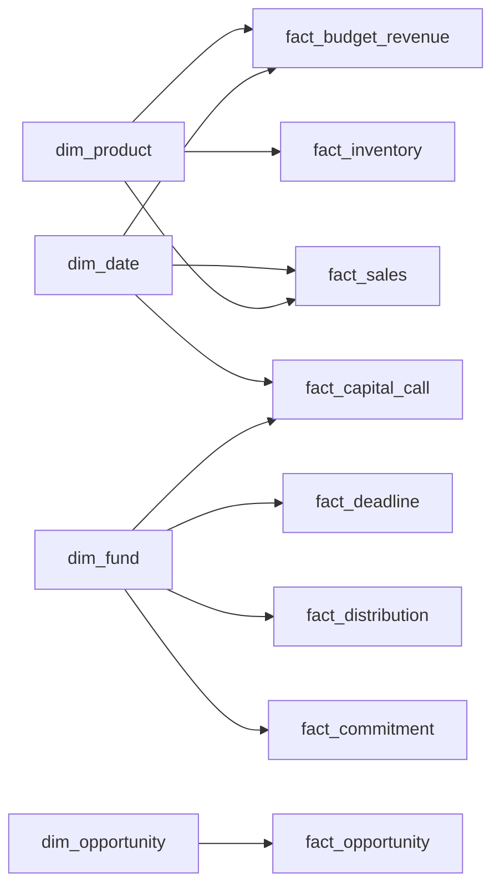

# Power BI build guide

This is a build guide, not a published report. There is no `.pbix` in the repository. Power BI Desktop is not required to run the Python toolkit. The tables in `outputs/powerbi/` are the model a desktop file would import. The same tables are loaded into `outputs/harborline.sqlite` for anyone who wants to query them with SQL.

Regenerate them with:

```bash
python -m fotoolkit run-all
```

## What to import

In Power BI Desktop: Get data, from Folder, point at `outputs/powerbi`, and combine only if you intend to. It is simpler to load each CSV on its own so the table names stay as the file names.

| Table | Grain | Role |
| --- | --- | --- |
| `dim_date` | One row per date used in the sample | Date role on `full_date` |
| `dim_fund` | One row per fund | Fund name and strategy |
| `dim_product` | One row per Cedar Bend product line | Product name |
| `dim_opportunity` | One row per pipeline name | Sponsor, asset class, stage |
| `fact_commitment` | One row per fund, at the as-of date | Commitment, called, unfunded, DPI, RVPI, TVPI, residual IRR |
| `fact_capital_call` | One row per notice | Amount and status |
| `fact_distribution` | One row per distribution notice | Amount and status |
| `fact_deadline` | One row per report due | Status |
| `fact_sales` | One valid sales row | Revenue, COGS, gross profit. Exception rows are not here |
| `fact_budget_revenue` | Month × product line | Revenue and COGS budget |
| `fact_month` | One row per month, July–October 2026 | Company-level actual and budget |
| `fact_purchasing` | One valid purchase order | Cash and inventory signal, not COGS |
| `fact_inventory` | One clean SKU | On-hand value and reorder flag |
| `fact_exception` | One failed source row | The audit list |
| `fact_opportunity` | One pipeline name | Score, band, flags |
| `fact_priority` | One principal priority | Hand-authored, not from the summarizer |
| `fact_task` | One operating follow-up | Hand-authored |
| `fact_review` | One draft summary | `review_status` stays pending until a person approves |

Mark `full_date` as a date. The `*_date_key` columns are integers `YYYYMMDD` and are the relationship keys. A blank `received_date_key` means the report has not arrived.

## Relationships



Suggested cardinality, all many-to-one, single direction from the dimension into the fact:

| From | To |
| --- | --- |
| `fact_commitment[fund_key]` | `dim_fund[fund_key]` |
| `fact_commitment[as_of_date_key]` | `dim_date[date_key]` |
| `fact_capital_call[fund_key]` | `dim_fund[fund_key]` |
| `fact_capital_call[due_date_key]` | `dim_date[date_key]` |
| `fact_distribution[fund_key]` | `dim_fund[fund_key]` |
| `fact_distribution[expected_date_key]` | `dim_date[date_key]` |
| `fact_deadline[fund_key]` | `dim_fund[fund_key]` |
| `fact_deadline[due_date_key]` | `dim_date[date_key]` |
| `fact_sales[product_key]` | `dim_product[product_key]` |
| `fact_sales[date_key]` | `dim_date[date_key]` |
| `fact_budget_revenue[product_key]` | `dim_product[product_key]` |
| `fact_budget_revenue[month_date_key]` | `dim_date[date_key]` |
| `fact_inventory[product_key]` | `dim_product[product_key]` |
| `fact_opportunity[opportunity_key]` | `dim_opportunity[opportunity_key]` |

`fact_month` is already at company grain. Do not relate it to `fact_sales` or the revenue measure will fan out. Use `fact_month` for the July–October trend and `fact_sales` with `fact_budget_revenue` for product detail.

`fact_purchasing[date_key]` can relate to `dim_date`. Leave it unrelated to `fact_sales`. Purchasing is not COGS.

## Measures

These are starting DAX measures, not a model that has been published. Names match the columns in the CSVs.

```DAX
Unfunded = SUM ( fact_commitment[unfunded] )

Called = SUM ( fact_commitment[called_to_date] )

Percent called =
DIVIDE ( [Called], SUM ( fact_commitment[commitment] ) )

Overdue calls =
CALCULATE (
    SUM ( fact_capital_call[amount] ),
    fact_capital_call[status] = "Overdue"
)

Calls due in 30 days =
CALCULATE (
    SUM ( fact_capital_call[amount] ),
    fact_capital_call[status] = "Due in 30 days"
)

Revenue = SUM ( fact_sales[amount] )

Revenue budget = SUM ( fact_budget_revenue[revenue] )

Revenue variance = [Revenue] - [Revenue budget]
```

On this sample, after a refresh, Unfunded is 8,150,000 and Overdue calls is 400,000. If a visual disagrees, the relationship is the first place to look, not the CSV.

## Pages to build

1. **Executive.** Cards for unfunded, overdue call amount, October revenue variance from `fact_month` where `year_month` is 2026-10, and a count of `fact_review` where status is pending. A table of high and medium items can be built from calls and deadlines filtered to Overdue and Due in 30 days.
2. **Capital.** A matrix of fund, commitment, unfunded, TVPI, residual IRR. A table of calls with status. Do not format residual IRR as a multiple. It is a rate, and it assumes NAV is realized on the as-of date.
3. **Cedar Bend.** Clustered column of `fact_month[revenue]` and `fact_month[revenue_budget]`. A product matrix from `fact_sales` and `fact_budget_revenue` for October. A table of `fact_inventory` where `below_reorder` is 1. Put `fact_exception` on the same page so the exclusion is visible.
4. **Pipeline.** `fact_opportunity` with the band, the score, the ask, and the flag text. Sort Advance, Watch, Pass.

## Refresh

The Python job is the refresh. Re-run `python -m fotoolkit run-all`, then Refresh in Power BI Desktop. A scheduled refresh in the service would need the CSVs in a gateway-visible folder or a SharePoint library. Copying them there is an operations step. It is not set up in this repo.

## SQL equivalent

`docs/example_queries.sql` runs against `outputs/harborline.sqlite`. The overdue-call query is the check that the model and the workbook still agree.
