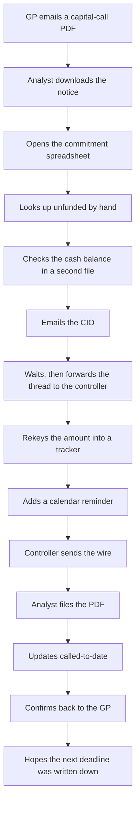
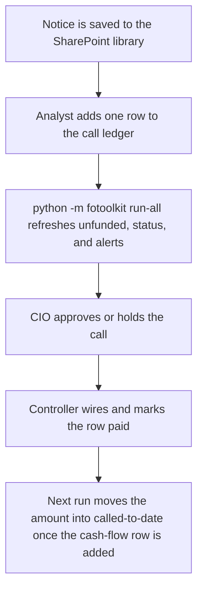
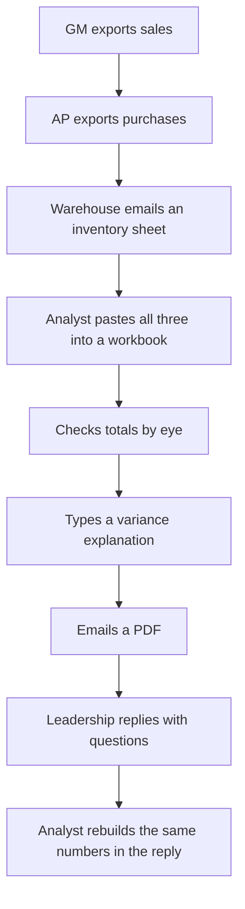
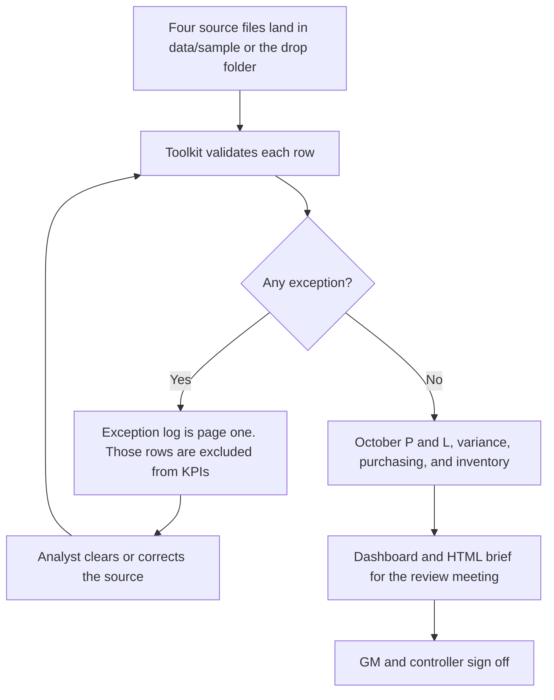
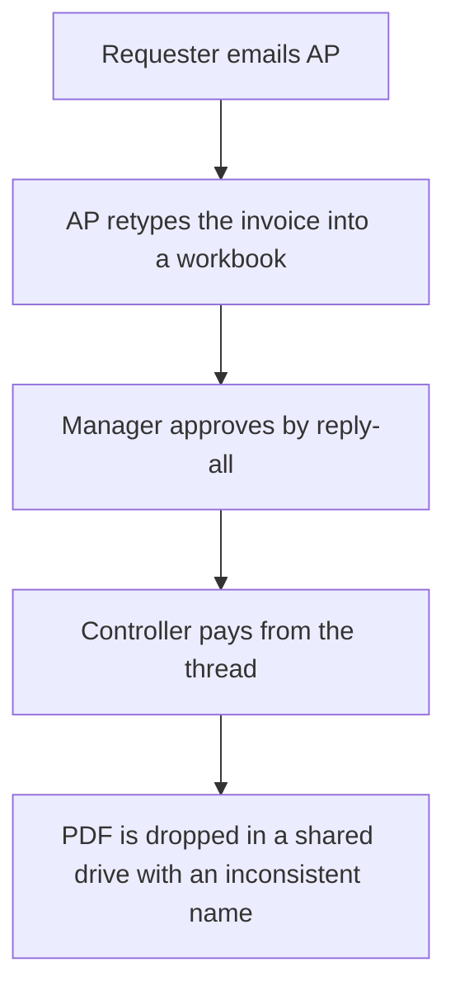
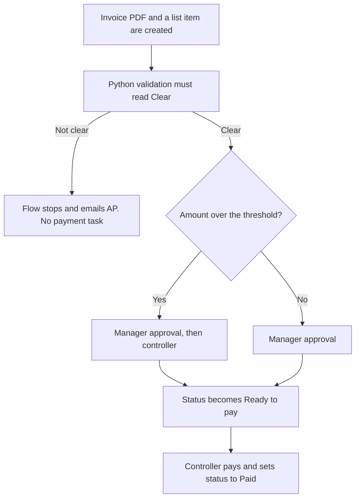

# Workflow maps

Harborline Family Office and Cedar Bend Supply are fictional. The step counts and hours below are **illustrative design estimates** for those fictional processes. They are not measured savings from a live company, and they are not a claim about any employer.

The shape of each change is the same: the analyst stops retyping, the workbook or the dashboard calculates, and a person still approves anything that moves money or goes to the principal.

## What the estimates count

A "step" is a handoff or a manual action (download, rekey, email, check a cell by eye, file a PDF). Judgment steps stay. The hours are elapsed analyst time for one occurrence, not calendar time waiting on a manager.

| Process | Steps before | Steps after | Illustrative analyst time before | After | Steps removed |
| --- | ---: | ---: | --- | --- | ---: |
| Capital call | 14 | 4 | 6 hours | 45 minutes | 10 |
| Monthly management report | 18 | 5 | 2 days | 3 hours | 13 |
| Invoice / PO approval | 11 | 4 | 4 hours | 1 hour | 7 |

## 1. Capital call

Money leaves the family. The tracker can show unfunded commitment, due date, and cash need. It cannot decide to fund.

### Before

### After

The approval step is specified in [power-automate-design.md](power-automate-design.md). It is not a flow running in a tenant. On the sample ledger, as of 12 November 2026, this is the item the new path would have surfaced without anyone hunting through email: Gulf Prairie call CC-1041, $400,000, due 28 October, still open.

## 2. Monthly management report

Cedar Bend's close was a paste-up. The useful change is that bad rows are listed before anyone reads the margin.

### Before

### After

On this sample, nine rows fail a check and stay out of the October figures. Revenue is $462,000 against a $480,000 budget. The gross-margin rate is 34.54% versus 34.53% budget, so the dollar miss is volume, not the cost ratio. That sentence is the point of the automation: it is the same every month, and a person can trace it to the invoices.

Sign-off is a designed approval, not a deployed flow. See the management-report flow in the Power Automate note.

## 3. Invoice and PO approval

### Before

### After

The threshold in the design note is an illustrative $5,000. It is a parameter, not a number this sample calculated. Cedar Bend's purchasing file is the stand-in for the source extract: October has $305,400 of valid receipts and two rows the validator refuses (a negative amount, and a blank vendor).

## What stays manual on purpose

- The decision to fund a call.
- The investment-committee decision. Screening memos recommend a band. They do not place an order.
- Wiring cash and signing a report.
- Promoting a sentence in meeting notes into a task, unless it was written as an explicit action and a person approved the draft.
